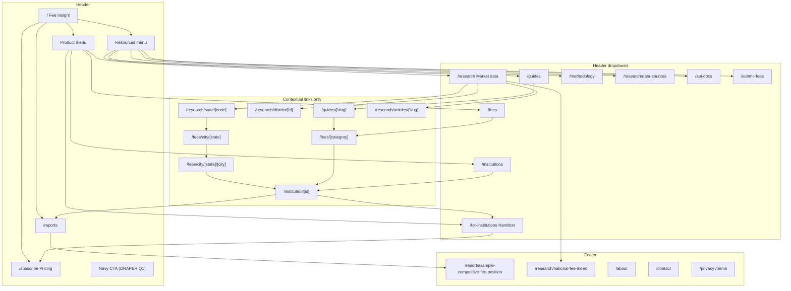

# Site v3 brief 05: architecture, navigation and SEO keep-list (ERNEST)

> **Goal updated 2026-10-15 (James).** The site's goal is a Hamilton Pro subscription, monthly or
> annual. The paid report is a high-value lead, not the goal. The funnel: a free sample report, then
> the Competitive Fee Position Report ("from $300"), then Pro, either because the buyer wants it on a
> regular basis or because the report sparks a Pro demo request (through `/contact?source=demo`; no
> booking links). Where anything below ranks the report above Pro, this note wins.

Issue #1289. Written 2026-10-14 from the code on branch `docs/site-v3-brief` (routes under
`src/app`, `src/app/sitemap.ts`, `src/app/robots.ts`, `src/proxy.ts`, `src/lib/llms-txt.ts`, the nav
files in `src/components/`) and briefs 01 to 03. It builds on DRAPER's positioning: three layers
with the public labels **Every fee** (Bank Fee Index), **Every market** (the five market layers) and
**One workspace** (Hamilton), and DRAPER's vocabulary table. No traffic figures appear here: Search
Console and analytics were not available to this brief, so the SEO keep-list names pages and search
intents, not volumes.

## 0. The short version

- Keep every URL. The new positioning needs new labels, nav groups and links, not new addresses.
  No public route changes path, so the only redirect work is retargeting one existing redirect
  (`/waitlist`) and keeping the old ones.
- The header drops from six items plus a report pill to four items plus one navy CTA:
  **Product** (a three-column menu, one column per layer), **Reports**, **Resources**, **Pricing**.
- `/reports` becomes the home of every report (#1171). The header CTA follows DRAPER's primary
  conversion, not the report.
- Recommendation: no new `/hamilton` page yet. `/for-institutions` becomes the product page, with a
  `#hamilton` section; `/subscribe` stays the price page.
- The pages that carry search today are the templates: institution, fee category, state, district,
  city and guide pages. The redesign must leave their URLs, titles, headings, tables, structured
  data and noindex thresholds alone.

## 1. Page tree

```
Fee Insight (/)
├── Product  [header menu]
│   ├── Every fee
│   │   ├── Find your institution (/institutions)
│   │   │   └── Institution (/institution/[id])
│   │   └── Bank Fee Index (/fees)
│   │       └── Fee category (/fees/[category])
│   ├── Every market
│   │   └── Market data (/research)
│   │       ├── National fee index (/research/national-fee-index)
│   │       ├── State report (/research/state/[code])
│   │       │   └── Cities in a state (/fees/city/[state])
│   │       │       └── City (/fees/city/[state]/[city])
│   │       ├── Fed district report (/research/district/[id])
│   │       ├── Articles (/research/articles/[slug])
│   │       ├── Fee-to-revenue analysis (/research/fee-revenue-analysis)   gated, noindex
│   │       └── Market concentration (/research/market-concentration)      gated, noindex
│   └── One workspace
│       ├── Hamilton, the Pro workspace (/for-institutions, section #hamilton)
│       └── Pricing (/subscribe)                                            also its own header item
├── Reports (/reports)
│   ├── Sample Competitive Fee Position Report (/reports/sample-competitive-fee-position)
│   ├── Free national and district reports (/reports/benchmark/[scope])   noindex
│   └── Published reports (/reports/[slug])                                noindex
├── Resources  [header menu]
│   ├── Guides (/guides)
│   │   ├── Consumer guide (/guides/[slug])
│   │   └── Professional guide (/guides/pro/[slug])                         gated, noindex
│   ├── Methodology (/methodology)
│   ├── Data sources (/research/data-sources)
│   ├── API (/api-docs)
│   └── Submit a fee source (/submit-fees)
├── Company: About (/about), Contact (/contact)
├── Legal: Privacy (/privacy), Terms (/terms)
└── Outside the nav
    ├── Sign-in flow: /login, /register, /forgot-password, /reset-password, /confirm-email
    ├── Signed in: /account, /pro/* (Hamilton), /workspace-invite                robots-disallowed
    ├── Tokenized: /r/[token], /market-report/[token], /pay/report/[token]       robots-disallowed
    ├── Noindex utilities: /tools/price-check, /email-preferences
    └── Redirects: /pro, /consumer, /check, /districts, /waitlist, /pricing
```



## 2. URL map

Job: data (the Bank Fee Index), insight (market layers), workspace (Hamilton), conversion, trust,
content. Priority means how much the redesign must get the page right, not the sitemap value.

| URL | Job | Action | Nav zone | Priority |
|---|---|---|---|---|
| `/` | Conversion; front door for both audiences | Keep. New hero per DRAPER; keep the search and the `WebSite` SearchAction | Logo | High |
| `/institutions` | Data; the shared search ("See where your fees stand") | Keep | Product menu, CTA target | High |
| `/institution/[id]` | Data; becomes the buyer's free position view (DRAPER Q1 option B) | Keep. Numeric IDs stay; moving to slugs would need a 301 for every profile and gains little | Contextual | High |
| `/fees` | Data; topic page for "average bank fees" (review S2) | Keep | Product menu | High |
| `/fees/[category]` | Data | Keep | Contextual | High |
| `/research` | Insight hub: state, district, national | Keep URL; nav label becomes "Market data" | Product menu | High |
| `/research/national-fee-index` | Insight; the national layer as a dataset | Keep | Footer, contextual | Medium |
| `/research/state/[code]` | Insight; the state layer | Keep | Contextual, footer anchor `/research#states` | High |
| `/research/district/[id]` | Insight; the Fed district layer | Keep | Contextual, footer anchor `/research#districts` | Medium |
| `/fees/city/[state]` | Insight; city list | Keep. Noindex states with no indexable city (review S3). Folding into the state report with a 301 is a later option | Contextual | Low |
| `/fees/city/[state]/[city]` | Insight; the local layer | Keep | Contextual | Medium |
| `/research/articles/[slug]` | Content | Keep | Contextual | Low |
| `/research/fee-revenue-analysis`, `/research/market-concentration` | Workspace teasers (gated) | Keep, noindex; remove the footer link (review T7) | Contextual | Low |
| `/research/data-sources` | Trust | Keep | Resources menu | Low |
| `/for-institutions` | Workspace and product overview: all three layers, Hamilton section | Keep URL; rewrite as the product page (section 4) | Product menu | High |
| `/subscribe` | Conversion: Pro price and checkout, with the report beside it | Keep | Header "Pricing" | High |
| `/reports` | Conversion: the report's one home, free and paid (#1171) | Keep | Header "Reports" | High |
| `/reports/sample-competitive-fee-position` | Trust and conversion | Keep | Footer, contextual | Medium |
| `/reports/benchmark/[scope]`, `/reports/[slug]` | Free report output | Keep, noindex | Contextual | Low |
| `/guides`, `/guides/[slug]` | Content (consumer) | Keep | Resources menu | High (traffic) |
| `/guides/pro/[slug]` | Workspace teaser | Keep, noindex, out of the sitemap | Contextual | Low |
| `/methodology` | Trust | Keep | Resources menu, footer | Medium |
| `/about`, `/contact` | Trust | Keep | Footer | Medium |
| `/api-docs` | Trust (access by invitation) | Keep | Resources menu, footer | Low |
| `/submit-fees` | Trust; data corrections | Keep | Resources menu, footer | Low |
| `/privacy`, `/terms` | Legal | Keep | Footer | Low |
| `/tools/price-check` | Utility | Keep, noindex | None | Low |
| `/pro` | Redirect: Pro members to Hamilton, others to `/subscribe?from=%2Fpro` | Keep | None | Low |
| `/consumer`, `/check` to `/institutions`; `/districts` to `/research#districts`; `/pricing` to `/subscribe` | Redirects (`LEGACY_PATH_REDIRECTS` in `src/proxy.ts`, 301) | Keep | None | Medium |
| `/waitlist` | Redirect, now to `/for-institutions#report` | **Retarget** to `/reports?report=institution#request` when #1171 lands | None | Low |
| bankfeeindex.com, thebankfeeindex.com | Old domains, 301 to feeinsight.com (`src/proxy.ts`) | Keep for good: it carries the old domain's links | None | High |
| `/hamilton` | Workspace page | **Not now** (section 4). If James chooses it, it is new, not a rename, and needs no redirect | Product menu | James decides |

No URL is renamed or merged in this plan. One fragment changes meaning: `/for-institutions#report`
is linked from `src/app/subscribe/pricing-sections.tsx` (`REPORT_ANCHOR_HREF`), from the marketing
email builder (`src/lib/agents/marketing/email.ts`) and from emails already sent. A fragment cannot
be redirected, so when the form moves to `/reports`, `/for-institutions` keeps a short `id="report"`
section that links to `/reports#request` until those emails age out.

## 3. Navigation spec

### Header, signed out and signed-in free (desktop, `lg` and up)

```
[Fee Insight logo]  Product ▾   Reports   Resources ▾   Pricing      [search]  Sign in  [ Navy CTA ]
```

1. **Product ▾**: three short columns headed with DRAPER's labels, each link with a one-line
   description.
   - **Every fee**: Find your institution (`/institutions`); Bank Fee Index (`/fees`), "Every fee by
     category, with its median and range".
   - **Every market**: Market data (`/research`), "Your state, your Fed district and the nation";
     National fee index (`/research/national-fee-index`).
   - **One workspace**: Hamilton (`/for-institutions#hamilton`), "The Pro workspace: your fees
     against every market layer"; See Hamilton plans (`/subscribe`).
2. **Reports**: `/reports`. This is #1171's nav item.
3. **Resources ▾**: Guides (`/guides`), Methodology, Data sources, API, Submit a fee source.
4. **Pricing**: `/subscribe`. The label stays "Pricing", because a buyer looks for it by that word
   and `nav-items.test.ts` pins it.

On the right are the search trigger (keep `SearchTrigger`), "Sign in" as a text link, then one
filled **Oxford Navy** button. Its label and target follow DRAPER Q1. If James chooses option B,
it reads "See where your fees stand" and goes to `/institutions`. If the institution page is not yet
a buyer view at launch, it reads "See Hamilton plans" and goes to `/subscribe`. It is never "Request
your report" again: the report gets its own header item, so the CTA does not have to carry it. The
Explore data menu and the "For Institutions" item are retired. Their destinations live on in the
Product menu.

Keep "Market data" as the visible label and leave the `/research` page title's search words
("bank and credit union fee analysis") in place. The pillar heading on the page is DRAPER's "Every
market". "Insight" never appears as a heading.

Crawlability: menus must render their links in the server HTML, as `ExploreMenu` already does with
a `hidden` list. Every page that the header links site-wide today (`/institutions`, `/fees`,
`/research`, `/guides`, `/for-institutions`, `/subscribe`) is still linked site-wide after the change,
and `/reports` is added.

### Mobile drawer (below `lg`)

The drawer is a flat list with small group headings and no accordions, since it is short enough:

- the search button (label "Search banks, fees and guides", pinned by test);
- a **Product** heading with Find your institution, Bank Fee Index, Market data and Hamilton;
- Reports and Pricing;
- a **Resources** heading with Guides, Methodology and API;
- Sign in, then the navy CTA at full width.

On screens 640px and wider, show the CTA in the sticky header as well. At 375px there is room only
for the logo, search and the menu button.

### Footer

Replace the brand line "for consumers and banking teams" with one sentence in DRAPER's terms. It
must not run "Fee Insight" and "Bank Fee Index" together as one name, because `brand-kill` checks
that. The Bank Fee Index lockup sits in the footer (DECISIONS 2026-10-14 on
`feat/design-system-package`).

| Product | Resources | Company | Legal |
|---|---|---|---|
| Bank Fee Index (`/fees`) | National fee index | About | Privacy |
| Find your institution | State reports (`/research#states`) | Contact | Terms |
| Market data (`/research`) | District reports (`/research#districts`) | Submit a fee source | |
| Hamilton (`/for-institutions`) | Consumer guides | | |
| Reports (`/reports`) | Methodology | | |
| Sample report | Data sources | | |
| Pricing (`/subscribe`) | API | | |

This fixes three review findings. "State Reports" no longer points at `/research` (review T13b).
The footer gains Methodology and the sample report. The gated Fee-to-Revenue link goes (T7). The
email signup "Get the free report" should be relabeled to match what it sends; that is DRAPER's
copy to set.

### Signed-in Pro nav

No change. The tabs are This month, My fees, Try a price, Reports and Regulatory Wire
(`PRO_NAV_ITEMS`). The account menu holds My bank and data, Alerts and watches, the Reference pages
(Market, Institutions, Fee categories, Fed districts), Admin for staff, and Account and billing. All of
these labels are pinned by `nav-items.test.ts` and `consumer-mobile-nav.test.tsx`. The header logo
stays Fee Insight, and the Hamilton wordmark appears on `/pro` only, per DECISIONS.

### #1162 and #1171

- **#1171 (`/reports` as the report's home) should land before the v3 nav PR.** It adds "Reports"
  to the nav and footer, makes `/reports#request` the one form, retargets `/waitlist`, and points
  `REPORT_ANCHOR_HREF` and the email link at `/reports?report=institution#request`. v3 keeps all of
  that. Doing it first means `nav-items.ts` is restructured once, on top of it.
- **#1162 (the pill opens the paid report and drops the lock styling) is still worth shipping now.**
  Its form fix (no dashed border, muted text or lock icon on the paid option) stays in v3. Its
  pill target is temporary, because v3 gives the pill to DRAPER's primary CTA and moves the report
  to the Reports item. Say so in #1162 so no one treats the pill target as permanent.

### Tests and code that must change

- `src/components/nav-items.ts`:
  - Replace `PUBLIC_NAV_ITEMS`, `EXPLORE_NAV_*` and `REQUEST_REPORT_NAV` with grouped data
    (`PRODUCT_NAV_GROUPS`, `RESOURCES_NAV`, `REPORTS_NAV`, `PRIMARY_CTA_NAV`).
  - `navItemsFor` keeps its signature.
- `src/components/nav-links.tsx`: becomes the Product and Resources menus.
- `src/components/nav-account.tsx` and `src/components/consumer-mobile-nav.tsx`: change the
  imports and the CTA, and move from brick (`#C44B2E`) to the navy token from `src/brand/` (on `feat/design-system-package`, not on `main` yet).
- `src/components/consumer-nav.tsx`: change the re-export.
- `src/components/nav-items.test.ts`: both current tests pass unchanged (the Pro labels, and
  "Pricing" for signed-out and free users). Add tests for:
  - the signed-out top level (Product, Reports, Resources, Pricing);
  - each Product column's links;
  - the CTA's label and link;
  - no "Request your report" in the header.
- `src/components/consumer-mobile-nav.test.tsx`:
  - The "Guides" link with `aria-current` and the search button label stay, so keep "Guides" as
    the label.
  - The Pro test is unchanged.
  - The `isActivePath(..., "/for-institutions#report")` case still passes. Add a case for
    `#hamilton`, and assert the drawer's CTA.
- `src/components/customer-footer.tsx`: there is no footer test today. Add one that pins the four
  columns and checks that no footer link points at a noindexed page.
- `src/lib/llms-txt.test.ts`: see section 6.

## 4. Does Hamilton need its own public page?

There are three options.

1. **Reuse `/for-institutions` as the product page (recommended).** It already has the clearest
   Hamilton description on the site: the canonical line, the mode cards and "The report is a snapshot;
   Pro is the feed". It is in the sitemap at 0.9, and its title already targets the buyer's category
   term ("Bank Fee Benchmarking and Competitive Fee Reports"). Rewrite it top to bottom around the
   three layers, with a `#hamilton` section carrying the Hamilton lockup and the five tabs, and send
   its report form to `/reports` (#1171). One page per job: `/for-institutions` explains, `/subscribe`
   prices, `/reports` sells the one-off. That is the fix for the three overlapping "buy" pages
   (review S1). The cost is that the URL names an audience, not the product. Buyers do not type URLs,
   though, and the nav label is "Hamilton".
2. **A new `/hamilton` page.** It is the cleanest brand signal, and Hamilton has its own lockup.
   Today it would be thin. Every public Hamilton screenshot is switched off except on `/subscribe`
   (DRAPER `[NEED]`), "Hamilton" has no category search demand, and it would bring back a fourth
   page that overlaps `/for-institutions` and `/subscribe`. Revisit it once approved screenshots
   exist and the page can show each tab on a real, non-thin market. Then `/hamilton` takes the
   workspace detail and `/for-institutions` stays the overview.
3. **Make `/subscribe` the product page.** Its intent is the price and checkout, and it is the most
   conversion-ready page on the site (NORMAN). Loading it with product explanation would slow the
   buyer who has already decided.

## 5. Internal linking and breadcrumbs

Today, guides and fee pages link to `/fees/[category]` and to the filtered directory
`/institutions?fee=...`. State pages link cities, fee categories and `/institutions?state=...`. City
pages link institution profiles. The institution page links up to its state and city
(`profile-data.ts`) and to fee categories. Two gaps matter. Almost nothing on the content pages
points to the product pages, and guides never reach a state report.

**Hubs and their spokes:**

- **`/fees/[category]`** is the hub for one fee.
  - Spokes: the matching guide, the state reports for that fee, `/institutions?fee=` and
    `/research/national-fee-index`.
  - Each spoke links back to it.
- **`/research/state/[code]`** is the hub for one state.
  - Spokes: its cities, its Fed district, the fee categories, and the state's institution list.
  - Check that `/institutions?state=` renders crawlable profile links in the server HTML. If it
    does not, profiles are reached only through city pages and the sitemap.
  - The list is neutral: alphabetical or by size, never highest or lowest (review C8).
- **`/institution/[id]`** is the meeting point of the two audiences (DRAPER section 3).
  - Up: state, city and each fee's category page (exists), plus the guide for each fee family
    (new).
  - Across to the product, in one "Is this your institution?" block: the existing report link
    (`reportOfferHref`) and "See Hamilton plans" (`/subscribe`).
- **`/guides/[slug]`**:
  - Add a link to its fee category hub and to `/research` ("See this fee in your state").
  - The existing `/subscribe` and fee-alert links stay.
  - Add no product pitch in the body text: consumers read these.
- **Product pages link down to proof**:
  - `/for-institutions` links to `/research`, a state report, the sample report and `/methodology`.
  - `/reports` and the sample link to `/for-institutions#hamilton` ("Pro keeps this view
    current", NORMAN quick win 4).
  - `/subscribe` links to `/reports` for the one-off.
- **Anchor text** uses the page's own words: "overdraft fee benchmarks", "Washington bank fees",
  "Hamilton, the Fee Insight Pro workspace". Never "click here".

**Breadcrumbs** follow the hierarchy above, not the URL path, because city pages live under
`/fees/city` but belong to a state. Each gets `BreadcrumbList` JSON-LD from one shared helper.

| Page | Trail |
|---|---|
| Fee category | Home > Bank Fee Index > {Fee} |
| State report | Home > Market data > {State} |
| City list / city | Home > Market data > {State} > Cities / {City} |
| Fed district | Home > Market data > {District} |
| Institution | Home > {State} > {City} > {Institution} |
| Guide | Home > Guides > {Guide} |
| Sample report | Home > Reports > Sample report |

## 6. SEO keep-list

### Pages and search intents that carry the site today

No query or click data was available. This list is based on which pages are indexable and in the
sitemap (`src/app/sitemap.ts`), what their titles target, and how many pages each template
produces. Before launch, export the Search Console baseline described in Q6 and replace this
section with measured queries.

| Intent | Typical searches | Pages | Notes |
|---|---|---|---|
| One institution's fees (consumer, navigational) | "{bank name} fees", "{bank} overdraft fee", "{bank} fee schedule" | `/institution/[id]` | The largest template by page count. Title from `buildProfileTitle` ("{Name} Fees: Overdraft $X..."); noindex below `MIN_VERIFIED_FEES_FOR_OFFER` |
| A fee type (informational) | "average overdraft fee", "how much do banks charge for a wire", "NSF fee" | `/fees/[category]`, `/fees`, `/research/national-fee-index`, `/guides/[slug]` | Guide `seoTitle`s ("Overdraft Fees Explained: What Banks Charge and How to Avoid Them") and the "{Fee} Fee - National Benchmarks" titles |
| A place (local informational) | "{state} bank fees", "bank fees in {city}" | `/research/state/[code]`, `/fees/city/[state]/[city]`, `/research/district/[id]` | State and city pages below their thresholds are noindexed and left out of the sitemap |
| The brand (navigational) | "Fee Insight", "Bank Fee Index", the old bankfeeindex.com name | `/`, `/fees`, `/methodology` | The old-domain 301s carry the old links |
| The buyer category (commercial) | "bank fee benchmarking", "competitive fee analysis", "fee schedule comparison", "overdraft fee benchmarks", "peer fee study" | `/for-institutions`, `/reports`, `/subscribe` | The terms v3 is meant to win. We cannot see whether they rank today. |

### What must not lose rank

- **Template pages are out of the redesign's scope.** Institution, fee category, state, district,
  city and guide pages keep their URLs, titles, H1s, server-rendered tables and noindex rules.
  New nav and footer chrome is fine. Their body stays as it is, except for the added links in
  section 5.
- **Every page linked from the header today stays linked from every page** (section 3).
- **Homepage title.** The current title is "Fee Insight — Bank and credit union fees, traced to the
  source". If it changes, keep "bank and credit union fees" in it, for example "Fee Insight — Bank
  and credit union fee benchmarks by market" (60 characters). Keep the `Organization` and
  `WebSite` SearchAction JSON-LD, and keep a crawlable search form.
- **`/for-institutions`:** when the body is rewritten, keep "bank fee benchmarking" and
  "competitive fee reports" in the title and H1 area.
- **Redirects:** keep the old-domain 301s and `LEGACY_PATH_REDIRECTS`. Add a redirect for any URL
  that is ever removed.
- **Ship the copy rewrite and the nav change as separate PRs.** If rankings move, we can then tell
  which change caused it.

### Schema by page type

All of it is JSON-LD in a single `@graph`, with stable `@id`s: `{SITE_URL}/#organization`,
`/#website`, `/fees#dataset` and `/subscribe#hamilton`. Every price comes from constants, never
typed by hand. There is no `Review` or `AggregateRating`, because none exists.

| Page type | Schema |
|---|---|
| `/` | `Organization` (logo; add `sameAs` with the LinkedIn company page once confirmed); `WebSite` with `SearchAction` (exists) |
| `/fees`, `/research/national-fee-index` | `Dataset`. Add `license` (the terms URL, since there is no open license), `temporalCoverage`, `variableMeasured`, `isAccessibleForFree`, `creator.url` (review T11). Plus `BreadcrumbList` |
| `/fees/[category]`, `/research/state/[code]`, `/research/district/[id]` | `Dataset` on indexable pages, with `isPartOf` pointing to `/fees#dataset`. Keep `Article` with `dateModified` (the data refresh), `author` and `publisher` as the Organization. `BreadcrumbList` |
| `/institution/[id]` | `WebPage` with `about` set to `BankOrCreditUnion` (shipped); `BreadcrumbList` |
| `/fees/city/...` | `WebPage` and `BreadcrumbList` |
| `/guides/[slug]` | `Article` and `FAQPage` (exists; only where the visible Q&A matches); `BreadcrumbList` |
| `/for-institutions` | `WebPage` with `about` pointing to `/subscribe#hamilton` |
| `/subscribe` | `Product` (or `SoftwareApplication`, `applicationCategory: BusinessApplication`) named Hamilton. One `Offer` per `PRO_TIERS` entry, with `UnitPriceSpecification` and the monthly price. The one place the product entity is defined |
| `/reports` | `Service` for the Competitive Fee Position Report, with an `Offer` whose `priceSpecification.minPrice` comes from `REPORT_OFFER`, rendered as "From $300". `FAQPage` (exists, `report-faq.tsx`) |
| `/methodology` | `Article` (exists), `about` pointing to `/fees#dataset` |
| `/about`, `/contact` | `AboutPage` and `ContactPage`, each referring to the Organization |

### AI search and `llms.txt` (`src/lib/llms-txt.ts`, served at `src/app/llms.txt/route.ts`)

`llms.txt` already names the report, Hamilton (`HAMILTON_CANONICAL`), `/research#districts`,
`/methodology` and `/contact`, so review T12 is done. For v3, change the following:

- Regroup the sections under the three layers: "Every fee", "Every market", "One workspace", then
  "Reports" and "Contact". Each layer gets a one-sentence definition.
- Name the five market layers. State the minimum sample in words ("a median needs at least five
  institutions") so the no-digits test still passes.
- List Hamilton's tabs from `HAMILTON_MODES` plus `HAMILTON_WIRE_NAV`.
- Add the vocabulary rule: "competitors" are named local institutions, and the "peer group" is
  charter and asset size.
- Add what the product does not do. It does not advise any institution to change a fee, and
  monitoring is "once its schedule is re-read".
- Prices: the test "carries no counts" (`/\d{2,}/`) blocks "$150" and "From $300" today. Either
  keep prices out and say "public prices on /subscribe", or narrow the test so it allows only the
  prices rendered from `PRO_TIERS` and `REPORT_OFFER.priceLabel`. I lean toward the second: an
  assistant asked "how much does bank fee benchmarking cost" can then quote us, and SHERLOCK found
  no competitor shows a price.
- An optional later step is a `/pricing.md` built from the same constants, as the `ai-seo` skill
  suggests. Without approved screenshots or more content, there is no case yet for an
  `llms-full.txt`.
- Rewrite the `## Look up fees` heading only together with its test line in `llms-txt.test.ts`.

## 7. Open questions for James

1. **Header CTA.** This follows DRAPER Q1. *Recommend a navy "See where your fees stand" that
   goes to `/institutions`, or "See Hamilton plans" that goes to `/subscribe` until the institution
   page is a buyer view.* Never "Request your report" in the header.
2. **Hamilton's page.** *Recommend reusing `/for-institutions` as the product page, with a
   `#hamilton` section. Revisit `/hamilton` once screenshots are approved.*
3. **Hamilton at the top level.** Should Hamilton be its own header item, or sit inside Product?
   *Recommend inside Product, with "Pricing" at the top level.* If you want the workspace more
   visible, make it Product, Hamilton, Reports, Resources, Pricing, which is five items and still
   within the limit.
4. **"Research" becomes "Market data" in the nav.** *Recommend yes. The URL and the page's title
   words stay.*
5. **Order of work.** *Recommend #1171 first, then #1162's form fix, then the v3 nav PR, then the
   page copy PRs.* Each one is its own PR.
6. **Search Console baseline.** *Recommend giving ERNEST read access, or exporting the last three
   months of queries and pages, before the v3 launch.* Without it, nobody can say what the redesign
   changed. Per ERNEST's rules, any report afterwards would cover only what changed, not traffic.
7. **City directory pages (`/fees/city/[state]`).** *Recommend noindexing the thin ones now, and
   deciding whether to fold them into the state report (with 301s) after the baseline exists.*
8. **Organization `sameAs`.** Please confirm the Fee Insight LinkedIn company page URL.
9. **Prices in `llms.txt`.** *Recommend yes, rendered from the constants* (section 6).
