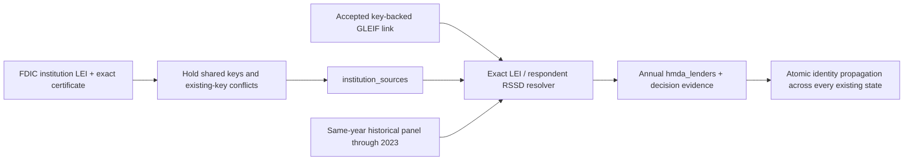

# 2026-10-19: HMDA matching repair and bounded rerun review

Status: pipeline fix and bounded execution path prepared for review; **no production writes, queued runs, migration, deployment, or automation-setting changes**. Outcome #2232, under #2225. Producer omission #2249; cross-state consistency #2250; panel conflict holds #2254; decision evidence #2255. Follow-up review: RSSD contradictions #2262, complete writer serialization #2263, bounded execution #2264, release holds #2265. Durable FDIC conflict holds #2266 remain a prerequisite for broader ordinary identity release.

**Guard:** HMDA parser/resolver/loader and manual-route tests, cron exclusion, release-gate tests and isolated PostgreSQL execution tests run in CI. The server-owned manifest enforces exact row sets and hashes; all three identity write gates default off.

**Lesson:** Verify that a publisher still supplies the identity input before interpreting successful aggregate ingestion as institution readiness. Repair the source producer and preserve ambiguity before attempting output relinking.

## Why every lender is unlinked

The loader assumed every LAR year also had a Reporter Panel containing the respondent RSSD. The panel stopped after 2023: the official 2023 ZIP exists; 2024 and 2025 return 404. The current HMDA institutions API samples also return `rssd=-1`. An older panel, parent RSSD, holding-company RSSD, display name, or mixed legacy institution ID cannot safely substitute for the same lender's identity.

FDIC now publishes institution LEIs, but our FDIC request, parser, and universe writer never collected them. The production registry snapshot has zero populated own LEIs and no canonical `institution_lei_links` rows. The old HMDA matcher only read own LEI or panel RSSD and ignored accepted canonical links. With both inputs absent, zero links is the expected result.

Secondary defects: the historical panel header is `topholder_rssd`; duplicate LEIs were last-row-wins; SQL selected the lowest institution ID on multiple matches; annual lender identity changes could leave other states' existing aggregate rows stale. These defects are fixed with the input pipeline, before any output repair.

Primary references: [CFPB snapshot](https://ffiec.cfpb.gov/data-publication/snapshot-national-loan-level-dataset/2025), [2023 panel](https://files.ffiec.cfpb.gov/static-data/snapshot/2023/2023_public_panel_csv.zip), [FDIC release notes](https://banks.data.fdic.gov/bankfind-suite/help?helpTopic=release-notes), [official FDIC identity response](https://api.fdic.gov/banks/institutions?filters=ACTIVE%3A1&fields=CERT%2CNAME%2CFED_RSSD%2CLEI&limit=10000&format=json), [HMDA institutions API](https://ffiec.cfpb.gov/documentation/api/institutions-api/). Public source checks and full responses are preserved in the local evidence bundle.

## Pipeline behavior after the change

- FDIC carries a normalized own LEI by exact source and certificate. Ownership is checked over the entire downloaded universe before chunks. Shared LEIs are withheld; existing nonblank canonical LEIs survive absent or conflicting new values. Receipts retain shared owners and conflicts.
- HMDA accepts a unique own LEI or a key-backed canonical link (`own_lei`, `rssd`, `fdic_cert`, `ncua_charter`). Weak name/state links remain excluded. RSSD padding is normalized; zero, negative, nonnumeric, conflicting, shared, and ambiguous identifiers remain unlinked.
- Historical conflicting panel duplicates are held, including a missing respondent RSSD on a duplicate. No parent or older-year fallback is used. Current years report the panel as discontinued without repeated 404 requests.
- Dry-run executes the same resolver and reports matched, unmatched, ambiguous, and reason counts without writes. Saved decisions distinguish publisher fields from crosswalks and freeze keys, source/basis/time and all candidate snapshots, including conflicts.
- The complete ordinary state database phase, from canonical reads through annual/child writes and stale removal, shares a transaction and annual advisory lock with repair. This prevents a later metric upsert from replaying a stale identity. Network collection finishes before the transaction. Failures roll back the complete state phase. New capture timestamps use the wall clock after lock acquisition so stale removal cannot delete just-written rows.

Ordinary FDIC own-LEI writes and ordinary HMDA identity replacement are **disabled by code-default-off release gates**. Existing annual IDs, match methods and matching evidence survive ordinary refreshes; new annual links remain null. Scheduled parser versions stay at 2 while the release is held, avoiding a deployment-triggered broad reread. Prospective dry-run matching remains available. The separate bounded apply/rollback gate is also false. These are prepared code changes; no production control was changed.

No new database schema or runtime surface is introduced. Existing TypeScript registry steps remain under the run ledger.

## Read-only evidence and expected coverage

Existing ingestion continued during investigation. The original audit snapshot had 4,387 lenders and 472,555 aggregate rows. At **2026-10-19 14:38:59 UTC**, the refreshed production snapshot had:

| Table | Rows | Linked institution IDs |
|---|---:|---:|
| `hmda_lenders`, 2025 | 4,570 | 0 |
| `hmda_lender_originations`, 2025 | 365,252 | 0 |
| `hmda_lender_loan_costs`, 2025 | 150,391 | 0 |

The frozen official FDIC response has 4,219 banks, with 2,264 reported LEIs. Six shared LEI groups cover 14 bank owners; withholding these yields **2,250 proposed canonical LEI fills**. Applying this full producer output only in an offline projection gives **1,759 matched / 2,811 unmatched** lenders in the refreshed 4,570-lender snapshot. These are projected counts, not completed production changes. Credit unions, mortgage companies, and other unmatched lenders need their own supported identity evidence; this result does not establish that every unknown lender belongs in our canonical universe.

Source SHA256: `8f4a898853932f6ab8dfef8ba1ccb29939c0cc7cfc726c0786a884a9bc26e558`. FDIC index `institutions_20261016090006`, created 2026-10-16T11:58:03Z. No research-only replacement dataset was ingested.

## Bounded first rerun proposal

Use stored 2025 HMDA aggregates; no LAR refetch, reaggregation, fee publication, or provider calls. The first proposal is limited to these ten FDIC certificate / institution / LEI triples and **every existing state** for those annual LEIs.

| Institution ID | FDIC cert | Institution | LEI | Origination / cost cells |
|---:|---:|---|---|---:|
| 3982 | 2682 | The First National Bank of Brooksville | 2549002H3CEW0748X068 | 7 / 3 |
| 3638 | 17410 | The Bendena State Bank | 2549003L98A6Z3YX9T46 | 6 / 4 |
| 1488 | 23886 | American Bank, National Association | 2549006VBLRP288VX853 | 22 / 12 |
| 3674 | 1730 | Peoples Bank of Greensboro | 2549009ACXPW8YN9HB36 | 7 / 3 |
| 3567 | 11466 | HomePride Bank | 254900ARBVNKXMFFP204 | 8 / 2 |
| 3621 | 34386 | Spring Valley Bank | 254900G0ZC4S8EO1W523 | 6 / 4 |
| 3671 | 20162 | Ascent Bank | 254900GRYB79SK58O657 | 6 / 4 |
| 1486 | 5072 | Range Bank | 254900HI61SSH8KEBQ58 | 9 / 1 |
| 2658 | 248 | State Savings Bank | 254900OZCVAL2OC4DT59 | 8 / 2 |
| 2650 | 737 | The Apple Creek Banking Company | 254900SJONZGRA3CJM44 | 6 / 4 |

Exact proposed impact: **10 existing canonical LEI fields, 10 annual lender identities, 85 origination identities, and 39 cost identities**. All reviewed prior identities are null. Proposed changes do not alter amounts, counts, medians, row counts, source capture timestamps or URLs. Matching decision metadata belongs in `hmda_lenders.raw_json.feeinsight_identity` with repair-run lineage. No canonical link-table rows are required.

The pure planner rejects non-explicit, duplicate or invalid LEIs; non-null existing annual links; missing/duplicate annual records or child censuses; more than 25 lenders; or more than 1,000 aggregate rows across all states. The proposal is tighter: **10 lenders and exactly 124 aggregate rows**. The old 100-cell preview is superseded because ongoing ingestion added cells for American Bank. Drift must never silently expand this proposal.

The [committed review manifest](../evidence/2026-10-19-hmda-rerun-manifest.json), also saved locally as `review-manifest.json`, records exact IDs, states, before/proposed values, source SHA256, before-image SHA256 and per-table source-fact hashes. The local evidence bundle's `review-snapshot.json` contains the actual before-images from one database snapshot. A later preflight must recapture and compare the exact reviewed row set and values. Any source/key/cell drift requires a revised manifest and review.

## Execution and rollback gates

**The bounded executor is implemented and tested, with apply/rollback disabled and nothing queued.** Production mutation remains a separate boundary. The ordinary FDIC and HMDA loaders are broader than this matching-only proposal and must not be used as a substitute for it. See the [manual execution contract](../checkpoints/2026-10-19-hmda-manual-execution-api.md).

1. Review code, source evidence, identity sample, exact manifest and authorization scope. All ten official same-year HMDA institution lookups and ten direct GLEIF records corroborate cohort labels and LEIs. Eight GLEIF records additionally carry the exact FDIC certificate; two use state business-registration namespaces. These reads do not supply missing HMDA RSSDs. HomePride's GLEIF entity is active but its LEI registration is lapsed, a freshness limitation to retain in the review; current FDIC/HMDA still corroborate the legal identity. Display names are a human cross-check, never an automatic matching input.
2. Review the matching-only TypeScript path. An authenticated admin may queue only the pinned server-owned configuration; callers cannot supply institutions or a replacement manifest. The step is excluded from cron drainage and needs explicit manual advancement through the existing execute endpoint. Even queueing/preview creates ledger rows, so neither was done in production for this task. An authorization-reference string is audit evidence, not approval by itself; enabling writes requires a separately reviewed code release after approval.
3. The executor verifies the fixed FDIC response digest under a 2 MiB/20-second fetch bound before acquiring database locks. Apply/rollback revalidate the running admin ledger owner, mode, cancellation state and matching run/step configuration. The transaction acquires advisory lock `(2253, 2025)` and `SHARE ROW EXCLUSIVE` locks on the five identity/child tables. Ordinary reads remain available; writers may wait briefly. Lock waits fail after 2 seconds and statements after 15 seconds. No locks are taken during the publisher fetch; preview uses a repeatable-read, read-only transaction. This table-lock scope must be part of operational execution review.
4. All selected annual children across all states are compared to the exact reviewed IDs and full database-JSON hashes, retaining timestamp microseconds. Any added/missing/changed row, source drift, key ambiguity or different resolver result aborts. Updates require exactly 10 canonical fills, 10 annual links, 85 origination links and 39 cost links. Full post-images must equal the permitted-field-only target, preserving amounts, metrics, capture times, source URLs and unrelated annual metadata. An immutable before/post-image receipt is inserted into `agent_run_events` in the same transaction. A retry checks that receipt and its current post-images and returns zero writes; step-completion status alone never decides whether a prior commit happened.
5. The guarded rollback path targets that apply receipt and restores the ten canonical LEIs and 134 HMDA identities/metadata only while the complete current row set equals its recorded post-images. It requires separate authorization, its own manual ledger run and the write release gate. Changed/new rows cause refusal; retries replay the rollback receipt without writing again. No direct SQL-console repair or ad hoc runtime script is introduced.

**Keep the PR draft and unmerged pending execution review.** Implementation parser versions are 3, while scheduled versions remain 2 behind the ordinary write gates. Enabling only the bounded gate does not enable broader rollout. Ordinary release additionally waits on #2266 so a preserved stored key cannot conceal newly shared/conflicting publisher evidence. The frozen manifest retains its original planning-status text; the execution contract here records the prepared implementation without changing its review digest.

Read-only recheck at **2026-10-19 15:06:05 UTC** reproduced every reviewed table hash and all 10/10/85/39 counts; the live official FDIC response still matched the pinned SHA256. Production PostgreSQL reports 17.6; no noninternal triggers or rewrite rules exist on the five scoped tables in that inspection. No production handler, queue endpoint or ledger-creating preview was invoked. Runtime checks repeat source/row validation immediately before any future write; this captured recheck is not execution authorization.

## Validation

Unit tests cover producer field parsing, exact/key-backed matching, weak and ambiguous evidence, RSSD sentinels/padding, panel retirement/duplicates, provenance snapshots, dry-run behavior, and bounded planning. Isolated loopback PostgreSQL tests exercise the real writer SQL and migration constraints, source/certificate targeting, preservation/conflicts, actual dry-run no-write transactions, all-state propagation/clearing, and failure rollback.

Final required gates and exact counts are recorded in the PR and local `validation-summary.md`: legacy guard, agentic suite, TypeScript, lint, complete Vitest suite and 22 real PostgreSQL integration tests. No database integration test connects to production. The production-data portion of #2232 stays open until an approved bounded execution and validation receipt exists.
